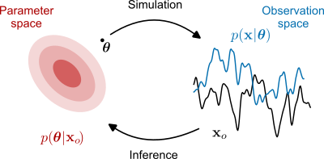
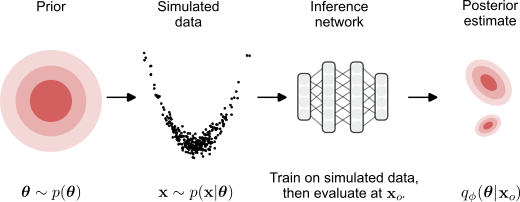
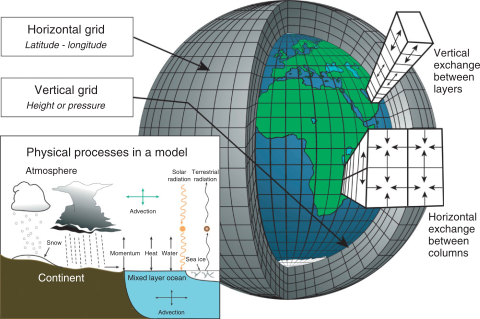

**Context**. Researchers are turning to machine learning to tackle tough problems in science, from biology to astrophysics and fluid dynamics. Our project is part of this growing AI4Science movement, focusing on a key challenge in experiments: figuring out which model parameters best match the data we observe (**[Figure 1](#fig1)**).
<figure>

<figcaption><b>Figure 1</b>: Given a stochastic simulator 
taking parameters $\theta$ as input and returning simulations $x \sim p(x|\theta)$, the posterior distribution $p(\theta|x_0)$ helps us determine the parameters which are the most likely to have generated observation $x_0$. Figure taken from [<a href="https://arxiv.org/abs/2508.12939" target="_blank">Deistler et al. 2025</a>]</figcaption>
</figure>

**Tools**. We use simulation-based inference (SBI) [[Cranmer et al. 2020](https://arxiv.org/abs/1911.01429), [Deistler et al. 2025](https://arxiv.org/abs/2508.12939)], a Bayesian approach that leverages deep generative models, such as conditional normalizing flows, to approximate the posterior distribution—assigning higher probability to parameter values most likely to have produced an observed data $x_0$ (**[Figure 2](#fig2)**).
<figure>

<figcaption><b>Figure 2</b>: SBI consist of four main steps: (i) draw parameters from the prior distribution $\theta_i \sim p(\theta)$, and (ii) run the simulator to generate data $x_i \sim p(x|\theta_i)$. (iii) Train over dataset $(\theta_i, x_i)$ a conditional generative model $q_\phi$ that takes $x$ as input and predicts a distribution over parameters $\theta$. (iv) Use $q_\phi(\theta|x_0)$ as an approximation to the posterior $p(\theta|x_0)$. Figure taken from [<a href="https://arxiv.org/abs/2508.12939" target="_blank">Deistler et al. 2025</a>]</figcaption>
</figure>

**Overarching goal**. SBI has so far been applied mainly to small-scale simulators. With SBI4C, <u>we aim to move from such simplified settings to large-scale models</u>, exemplified by climate simulators that capture complex ocean–atmosphere dynamics. 

**Climate models**. In this project, climate models serve both as a central application and as a source of inspiration for new methodological advances. A longstanding issue in this field is the calibration of model parametrizations, which has been widely discussed in the climate science literature and gained renewed attention in recent years [[Hourdin et al. 2017](https://journals.ametsoc.org/view/journals/bams/98/3/bams-d-15-00135.1.xml)].
<figure>

<figcaption><b>Figure 3</b>: Parametrizations are simplified mathematical representations of physical processes (like cloud formation or turbulence) that occur at scales smaller than the model grid. They are necessary because these fine-scale processes cannot be directly resolved by the model’s horizontal and vertical grids, yet strongly influence large-scale climate dynamics. Figure taken from [<a href="https://wires.onlinelibrary.wiley.com/doi/abs/10.1002/wcc.95" target="_blank">Edwards 2010</a>]</figcaption>
</figure>

**Directions**. Extending SBI from small-scale to large PDE-based simulators introduces specific difficulties: simulations are computationally expensive, the underlying processes span multiple scales, and reliable uncertainty quantification is essential. SBI4C addresses these issues through three complementary research directions:
- More with less : develop SBI methods that remain effective even when only a small number of expensive simulations are available.
- Smarter generative models : design posterior approximators that are lighter, multiscale-aware, and better suited to large scientific simulators.
- Fast surrogates : leverage climate emulators to replace costly simulations and test their impact on inference quality and trust.

**Impact**. By advancing the robustness and reproducibility of parameter inference methods in climate
science, the SBI4C project aims to make substantial contributions to the practices of
climatologists while enhancing the reliability of model-based projections for policymakers.
Moreover, the novel SBI methods we develop will be readily applicable to other domains
involving large-scale simulators, such as cosmology, computational neuroscience, and
civil engineering.